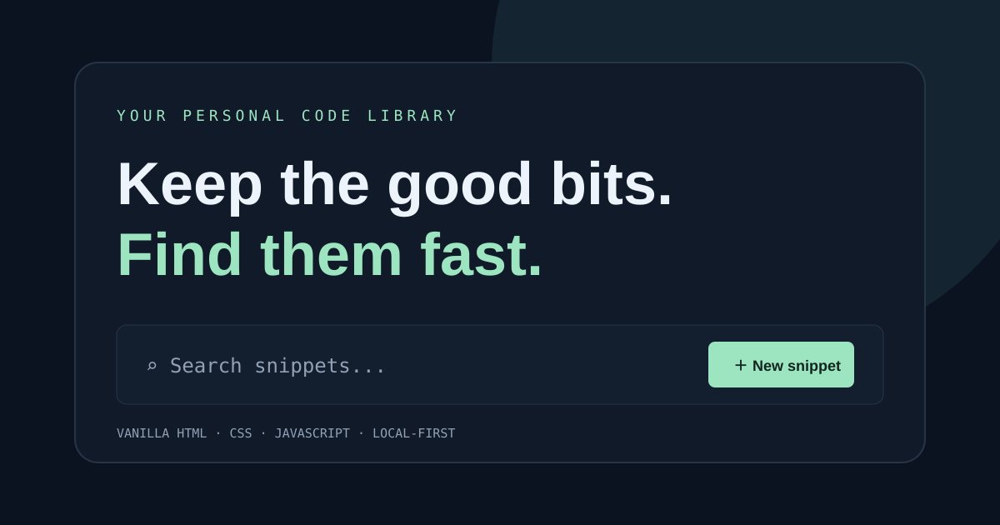

# Snippet Vault

A lightweight, responsive code-snippet library built with vanilla HTML, CSS, and JavaScript. Save reusable commands and code patterns, search your collection, filter by category, and copy snippets in one click.



## Features

- Add and delete custom snippets
- Search titles, notes, categories, languages, and code
- Filter snippets by category
- Copy code to the clipboard
- Persist data locally with `localStorage`
- Responsive layout for desktop and mobile
- Six useful starter snippets included

## Run locally

No build tools or dependencies required.

1. Download or clone this repository.
2. Open `index.html` in your browser.

For a local development server, run:

```bash
python -m http.server 8000
```

Then visit `http://localhost:8000`.

## Tech stack

- HTML5
- CSS3
- Vanilla JavaScript
- Browser Local Storage API
- Clipboard API

## Project structure

```text
snippet-vault/
├── index.html
├── styles.css
├── app.js
├── preview.svg
├── .gitignore
└── README.md
```

## Data and privacy

Snippets are stored in the browser's local storage on the device where they are created. There is no backend, account, or external database. Clearing browser site data will remove saved snippets, so export or copy anything important before doing so.

## Future improvements

- Import and export snippets as JSON
- Edit existing snippets
- Syntax highlighting
- Optional cloud sync

## License

MIT — see [LICENSE](LICENSE).
